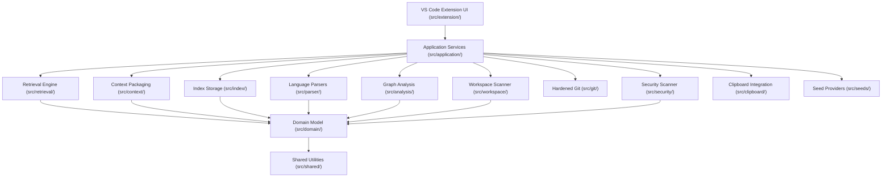

# Architecture

Offline Code Context Compiler (OCC) compiles repository source code and structural metadata into token-budgeted context packages for large language models. This document describes the system architecture, layers, data model, pipeline stages, index storage layout, and security boundaries.

## System layers and import boundaries

The codebase follows a strict layered architecture where dependencies point downward only. The boundaries are enforced by ESLint rules (`boundaries/dependencies` and `no-restricted-imports` in `eslint.config.mjs`).



### Layer boundary rules

1. `src/extension/`: The only layer permitted to import the `vscode` module. Manages command registration, status bar updates, preview webviews/editors, and configuration event listeners.
2. `src/application/`: Orchestration services (`OccApplication`, `IndexingService`, `ContextService`). Coordinates scanning, indexing, retrieval, and packaging. Does not import `vscode`.
3. Domain Engines:
 - `src/workspace/`: Directory traversal, file filtering, binary detection, and ignore rule evaluation.
 - `src/parser/`: AST parsing for TypeScript, JavaScript, JSON, and Markdown.
 - `src/analysis/`: Module resolution and dependency graph edge derivation.
 - `src/index/`: Sharded disk persistence and cache reconciliation.
 - `src/retrieval/`: Inverted lexical index, BM25 scoring, and structural graph traversal.
 - `src/context/`: Budget packing, truncation ladder execution, and wire formatting.
 - `src/security/`: Secret pattern scanning, entropy evaluation, redaction, and final leak gating.
 - `src/git/`: Safe, read-only git metadata extraction.
 - `src/clipboard/`: System clipboard writing and error formatting.
 - `src/seeds/`: Working-tree and editor seed collection.
4. `src/domain/`: Core types, graph definitions, and model interfaces (`model.ts`, `graph.ts`). Does not import any higher layers.
5. `src/shared/`: Primitive helpers for hashing, cancellation tokens, text processing, and error codes.

Because layers below `src/extension/` never import `vscode`, all domain logic, retrieval algorithms, and parsing run headlessly under Node in unit and property tests.

## Module map

The codebase is organized into fifteen modules under `src/`:

| Module Directory | Primary Responsibility | Key Invariants |
|---|---|---|
| `src/analysis/` | Module import resolution and dependency graph edge creation | Deterministic edge generation; unresolvable paths become explicit unresolved nodes |
| `src/application/` | Central application facade and indexing workflow orchestration | Single mutation queue; atomic transitions; debounced file watcher handling |
| `src/clipboard/` | System clipboard integration with fallback handling | Plain text export; no credentials leaked in error payloads |
| `src/context/` | Token budgeting, excerpt degradation ladder, and package formatting | Budget never exceeded; deterministic formatting; fail-closed leak gate before return |
| `src/domain/` | Abstract data types, graph structure, and index records | No external runtime dependencies; immutable data contracts |
| `src/extension/` | VS Code API adapter, commands, status bar, and views | Isolates `vscode` API; translates VS Code events into domain commands |
| `src/git/` | Hardened, read-only git command execution | Execution isolation flags; strictly read-only; trust-gated in untrusted workspaces |
| `src/index/` | Sharded file storage on local disk | Schema version 3; atomic writes via temp file and rename; manifest-entry consistency |
| `src/parser/` | AST parsing and symbol extraction | Fault-tolerant parsing; errors produce FAILED status records instead of crashing |
| `src/property/` | Property-based tests and invariant assertions | Seeded PRNG fuzzing; deterministic reproducibility |
| `src/retrieval/` | Lexical inverted index and structural graph ranking | Pure deterministic scoring; stable tie-breaking by file path |
| `src/seeds/` | Working-tree, editor, and diagnostic seed collectors | Safe failure outside git repositories; bounded seed collection |
| `src/security/` | Secret pattern detection, entropy scanning, and redaction | Deterministic placeholder generation; fail-closed leak check |
| `src/shared/` | SHA-256 helpers, cancellation, and error constants | Pure utility functions with zero side effects |
| `src/workspace/` | Filesystem walking, `.gitignore` parsing, and size checks | Sorted directory traversal; explicit recording of skipped files |

## Pipeline architecture

Context generation proceeds through five distinct pipeline stages:


### Stage 1: workspace scan
- Inputs: Workspace root directory, `excludePatterns`, `respectGitignore`, `maxFileSizeBytes`.
- Operation: `WorkspaceScanner` traverses directories in lexicographical order. Computes SHA-256 hashes of file contents, sniffs for binary bytes, and filters out excluded paths.
- Outputs: List of active files with size, content hash, and inclusion status.
- Complexity: O(N) where N is total file count.
- Determinism: Directory entries are sorted alphabetically before traversal.

### Stage 2: parse and index
- Inputs: Changed or unindexed files from Stage 1.
- Operation: `ParserRegistry` routes files to the appropriate parser. TypeScript and JavaScript files are parsed via the TypeScript compiler API into symbols, call sites, and import specifiers. Secret tokens are blanked before token extraction. Results are saved as atomic JSON entries in `IndexStore`. `AnalysisEngine` updates cross-file graph edges.
- Outputs: In-memory `DependencyGraph` and persisted index shards.
- Complexity: O(M * S) where M is changed files and S is average file size.
- Determinism: AST traversals and token harvesting follow source file text order.

### Stage 3: retrieval and ranking
- Inputs: Query text or seed file, user parameters (`maxGraphDepth`, `enableGitRecency`).
- Operation: `QueryAnalyzer` tokenizes query text. `InvertedIndex` scores files across symbol names (weight 3.0), file paths (weight 2.0), imports/exports (weight 2.0), summaries (weight 1.2), identifiers (weight 0.8), and body terms (weight 0.5). `HybridRetriever` merges lexical scores with graph structural expansion (dependency 0.6, dependent 0.5, calls 0.5, tests 0.7, inheritance 0.6).
- Outputs: Ranked list of candidate files with individual signal scores and WHY explanations.
- Complexity: O(T + E) where T is matching terms and E is traversed graph edges.
- Determinism: Ties are broken by POSIX relative file path.

### Stage 4: budget packing and degradation ladder
- Inputs: Ranked candidate list, user budgets (`maxFiles`, `maxChars`, `maxLines`, `maxTokens`).
- Operation: `ContextBuilder` iterates candidates in rank priority order. Fits files into available budgets using a four-step degradation ladder:
 1. Full file: Entire source text included.
 2. Symbol blocks: Excerpts focused around relevant symbols.
 3. Declarations: Signatures and interfaces only.
 4. Metadata only: File path and summary retained; source body omitted.
- Outputs: Structured context package string conforming to Wire Format v1.
- Complexity: O(C) where C is candidate file count.
- Determinism: Candidates are evaluated in strict rank order; formatting uses fixed templates.

### Stage 5: security leak gate
- Inputs: Final compiled context package string.
- Operation: Scans the complete finalized package for high-entropy tokens and secret patterns. If an unredacted secret is detected, packaging aborts with an error rather than exporting.
- Outputs: Verified context package or security error.
- Complexity: O(P) where P is context package length in characters.
- Determinism: Pure regex and Shannon entropy calculation.

## Local index storage layout

The local index is stored on the local file system inside VS Code workspace storage (`context.storageUri.fsPath`). For headless CLI runs and tests, the store path defaults to a `.occ-store` directory under the repository root.

```
<storageUri>/
  manifest.json
  entries/
    0a/
      0a3f8b...c1.json
    ff/
      ffe120...4d.json
```

### Storage characteristics

1. Schema Version: `STORE_SCHEMA_VERSION = 3`. If the store on disk was generated with an older schema (such as schema 1 or 2), the entire store is automatically cleared and rebuilt on first load.
2. Manifest (`manifest.json`): Contains `schemaVersion`, `projectFingerprint` (SHA-256 hash of the normalized workspace root path), `entryCount`, and a sorted map of workspace-relative paths to content hashes.
3. Shards (`entries/xx/<hash>.json`): Each file entry is stored in a separate JSON file. The path is derived as `entries/${hash.slice(0, 2)}/${hash}.json`, where `hash` is the SHA-256 hex digest of the POSIX file path.
4. Atomic Writes: Every entry shard and the manifest are written to a temporary file (`<target>.tmp.<pid>.<timestamp>`) and renamed into place using `fs.renameSync`. This prevents partial writes if the process terminates unexpectedly.
5. Invalidation and Rebuild: On startup, `IndexStore` verifies that `projectFingerprint` matches the active workspace and `schemaVersion` equals 3. If either check fails or the manifest is missing, the store wipes stale entries and re-indexes.

### Stored fields in `FileEntry`

Each entry shard JSON file contains:
- `meta`: File path, language identifier, size in bytes, line count, SHA-256 content hash, test flag, and parse status.
- `symbols`: Declared classes, functions, interfaces, methods, properties, variables, and headings with line ranges and signatures.
- `imports`: Imported module specifiers, imported symbol names, and external package flags.
- `exports`: Exported identifiers and line numbers.
- `calls`: Enclosing symbol ID and called identifier name.
- `fileSummary`: File-level summary comment or Markdown heading overview.
- `identifiers`: Unique source code identifiers harvested for lexical search.
- `bodyTokens`: Token frequency list of non-stopword code terms for BM25F lexical matching.
- `bodyLength`: Total body token count before term frequency capping.
- `internalRelations`: Internal symbol relationships (extends, implements, calls).

### Secret-token filtering in index shards

Before extracting `identifiers`, `bodyTokens`, and `fileSummary`, file content is scanned using `SecretScanner.scanSpans()`. All spans matching known secret patterns (API keys, private tokens, high-entropy credential assignments) are blanked with whitespace characters. This guarantees that credentials matching the secret scanner are never persisted in on-disk index shards.

Stated Limit: Filtering blanks only values flagged by the secret scanner. Values that the scanner does not flag, such as short passwords or low-entropy credentials, are still tokenized. Furthermore, word-like fragments such as key-type prefixes (for example, `AKIA` or `sk_live`) remain in token lists. Versions up to 0.3.1 persisted raw secret tokens in the local index; schema version 3 clears older stores to eliminate legacy shards.

## Git integration and hardening

OCC interacts with git exclusively through `safeGit` (`src/git/safeGit.ts`). Git interactions are strictly read-only and designed to avoid command execution hazards:

1. Global Flags: Every `execFile` call passes `-c core.fsmonitor= -c diff.external= -c core.textconv= -c filter.clean= -c filter.smudge=`. This prevents repository configuration from invoking arbitrary binaries during git operations.
2. Argument Arrays: Commands use `child_process.execFile` with explicit argument arrays, bypassing shell interpreters entirely.
3. Workspace Trust: In untrusted workspaces (`vscode.workspace.isTrusted === false`), git features are completely disabled. No git processes are spawned, and `enableGitRecency` is bypassed.
4. Asynchronous Cache: Git metadata is prefetched asynchronously into a local cache. Retrieval operations read exclusively from the in-memory cache, ensuring git execution never blocks query response times.
